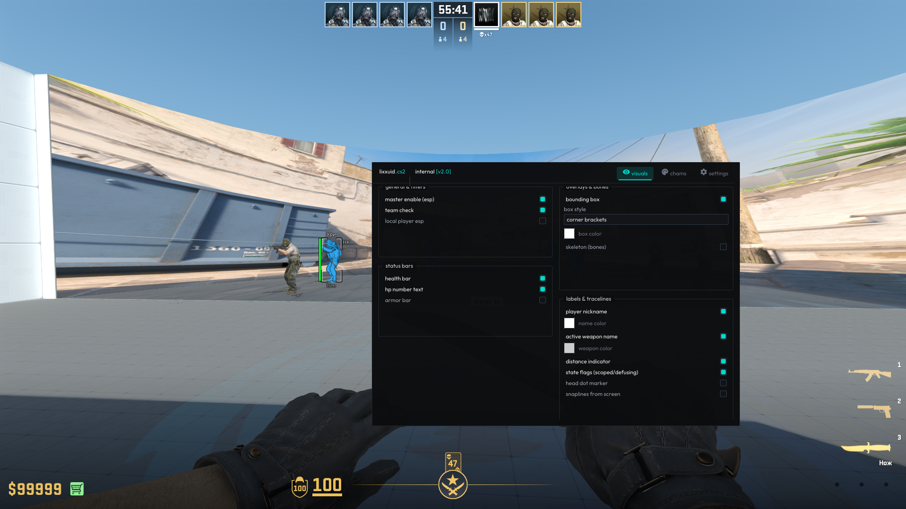
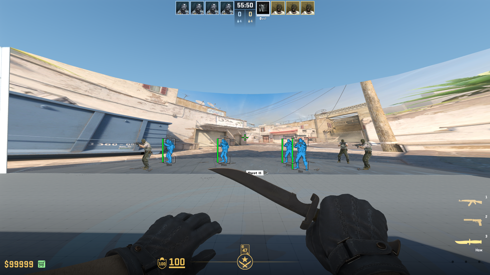

# LIXXUID // DirectX 11 Desktop Overlay Framework

Модульный исследовательский C++20 фреймворк, демонстрирующий перехват графического конвейера DirectX 11, рендеринг векторного графического интерфейса Dear ImGui и работу с памятью в 64-битной среде Windows.

> [!NOTE]
> **Статус проекта: Active Development (WIP)**  
> Проект создан в образовательных целях для изучения архитектуры графических конвейеров, таблиц виртуальных методов (VMT) и рендеринга пользовательских интерфейсов поверх 3D-приложений.

---

## Визуальная демонстрация

| Панель управления (UI) | Проекция видового экрана |
| :---: | :---: |
|  |  |

---

## Архитектура проекта

```
lixxuid/
├── CMakeLists.txt
├── setup_deps.ps1
├── media/
│   ├── 1.png
│   └── 2.png
│
├── deps/
│
└── src/
    ├── core/
    │   ├── dllmain.cpp
    │   ├── hooks.hpp / .cpp
    │   └── interfaces.hpp / .cpp
    │
    ├── memory/
    │   ├── address.hpp
    │   ├── pattern.hpp / .cpp
    │   └── schema.hpp / .cpp
    │
    ├── source2/
    │   ├── types.hpp
    │   └── entity.hpp / .cpp
    │
    ├── render/
    │   └── render.hpp / .cpp
    │
    ├── menu/
    │   ├── menu.hpp / .cpp
    │   ├── ui_theme.hpp
    │   ├── menu_anim.h
    │   └── outfit_regular.h
    │
    ├── features/
    │   ├── visuals/
    │   │   └── visuals.hpp / .cpp
    │   ├── chams/
    │   │   ├── chams.hpp / .cpp
    │   │   └── material.hpp
    │   └── removals/
    │       └── removals.hpp / .cpp
    │
    └── utils/
        ├── math.hpp
        └── log.hpp
```

---

## Сборка из исходного кода

### Системные требования
- Операционная система: Windows 10/11 x64
- Компилятор: Microsoft Visual C++ (MSVC) с поддержкой стандарта C++20
- Система сборки: CMake 3.20 или новее

### Порядок сборки
1. Загрузите внешние зависимости:
   ```powershell
   .\setup_deps.ps1
   ```
2. Сконфигурируйте и соберите проект через CMake:
   ```powershell
   cmake -B build -A x64
   cmake --build build --config Release
   ```
3. Итоговый динамический модуль располагается по пути: `build/bin/Release/lixxuid_cs2.dll`.

---

## Управление

- **`INSERT`** / **`DELETE`** — Показать или скрыть графическую панель параметров.
- **`END`** — Полное корректное снятие хуков и выгрузка модуля из процесса.

---

## Лицензия

Проект распространяется на условиях лицензии [MIT License](LICENSE).  
Предназначено исключительно для образовательных и исследовательских целей.
